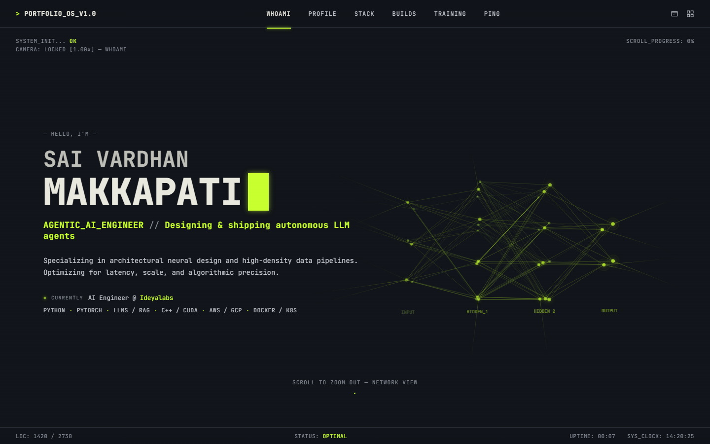
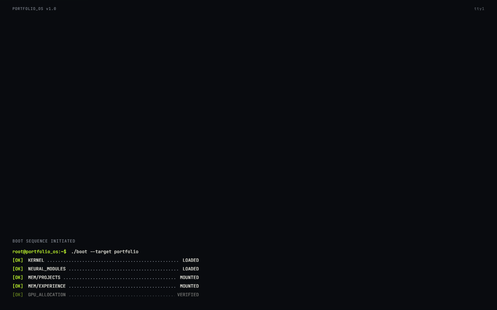
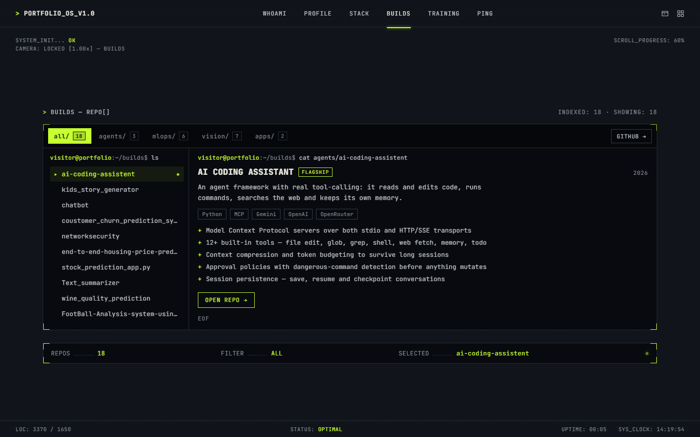
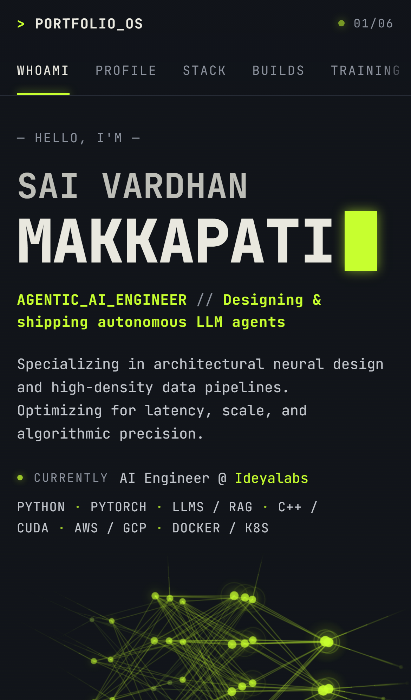

# PORTFOLIO_OS

**Sai Vardhan Makkapati — Agentic AI Engineer.** A personal portfolio built as a terminal-style operating
system: it boots, you fly a camera through it, and every section reads like a shell session.

**Live:** https://saivardhan4694.github.io/Vardhan_Makkapati/



| Boot | Builds | Mobile |
|---|---|---|
|  |  |  |

## What's interesting here

- **Terminal boot.** The whole viewport is a terminal; a typed boot command, status lines and a progress bar
  grow from the bottom-left before the interface launches.
- **Scroll-driven 3D camera (desktop).** Six sections — WHOAMI, PROFILE, STACK, BUILDS, TRAINING, PING — sit on
  one canvas as nodes of a network graph. Scrolling flies a GSAP-driven camera rig between them; the nav jumps
  straight to any node.
- **A real linear layout on mobile, not a shrunk desktop.** Below 1200px, on short screens, or without a fine
  pointer (phones, tablets, iPad), the camera is swapped for a stacked layout with a sticky, swipeable tab strip,
  section reveals and a full-width network band. Same components and data, so the two layouts never drift apart.
  Desktop rendering is unaffected (verified pixel-identical).
- **Live neural-net hero.** A canvas network animates behind the intro, capped to 30fps on touch devices.
- **Builds browser.** Projects are filterable by category (agents / mlops / vision / apps) with a `ls`/`cat`
  style detail view, all driven from typed data.
- **Mobile regression tests in CI.** A Playwright check runs at 360 / 375 / 390 / 412 / 768px and 844×390
  landscape on every push and asserts no horizontal overflow, readable text, 44px tap targets, sideways-only
  scroll strips, a correctly rendered hero graph, and that nav jumps land on the right section.

## Stack

React 19 · TypeScript · Vite · GSAP · Canvas 2D · Playwright · Oxlint · GitHub Actions · GitHub Pages

## Project layout

| Path | |
|---|---|
| `site/src/App.tsx` | Boot loader, then the scene |
| `site/src/components/BootLoader.tsx` | Full-screen terminal boot sequence |
| `site/src/components/Scene.tsx` | Desktop scroll-camera scene and HUD |
| `site/src/components/LinearScene.tsx` | Mobile / tablet linear layout with sticky tab strip |
| `site/src/components/NeuralNet.tsx`, `GraphLayer.tsx` | Hero network canvas and section graph |
| `site/src/components/sections/` | WHOAMI, PROFILE, STACK, BUILDS, TRAINING, PING |
| `site/src/data/` | Projects, highlights, camera path and graph layout |
| `site/src/lib/layoutMode.ts` | Picks camera vs linear layout |
| `site/src/lib/navNode.ts` | `goToNode` — one navigation contract for both layouts |
| `site/scripts/mobile-check.mjs` | Playwright mobile regression check |
| `design/` | Design explorations |

## Run locally

Needs Node 20+.

```bash
cd site
npm install
npm run dev            # http://localhost:5173
npm run build          # type-check + production build into site/dist
npm run lint
```

Mobile check (against a production build):

```bash
cd site
npm run build && npx vite preview --port 4173 &
BASE_URL=http://localhost:4173/ npm run test:mobile
```

## Deploy

Pushing to `main` runs `.github/workflows/deploy.yml`, which builds `site/` and publishes it to GitHub Pages.
`.github/workflows/mobile-check.yml` runs the mobile check on `main`, `claude/**` branches and pull requests.

## Contact

Reach out through the PING section of the live site.
